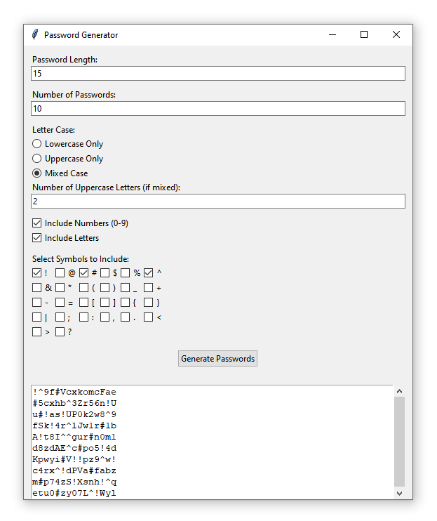

# Password Generator

A desktop password generator built with **Python** and **Tkinter**. The application generates multiple passwords with customizable length, letter case, numbers, and symbols. Password characters are generated using Python's `secrets` module for security-focused random generation.

## Features

* Generate multiple passwords at once
* Choose password length
* Choose the number of passwords to generate
* Lowercase-only passwords
* Uppercase-only passwords
* Mixed-case passwords
* Choose the number of uppercase letters in mixed-case passwords
* Include or exclude numbers
* Select individual symbols to include
* Automatically shuffle generated password characters
* Simple desktop interface using Tkinter
* No external packages required

## Screenshot



## Technologies

* Python 3.7+
* Tkinter
* `secrets`
* `string`

## Requirements

This application uses only Python's standard library.

Python 3.7 or newer is recommended.

## Project Structure

```text
password-generator-python/
├── password_generator.py
├── screenshots/
│   └── main-window.png
├── requirements.txt
├── .gitignore
└── README.md
```

## Installation

Clone the repository:

```bash
git clone https://github.com/yourusername/password-generator-python.git
```

Open the project directory:

```bash
cd password-generator-python
```

Run the application:

```bash
python password_generator.py
```

No additional packages need to be installed.

## How It Works

The application allows the user to configure several password-generation options:

1. Enter the desired password length.
2. Enter the number of passwords to generate.
3. Choose lowercase, uppercase, or mixed-case letters.
4. If mixed case is selected, specify how many uppercase letters should be included.
5. Choose whether to include numbers.
6. Select individual symbols.
7. Click **Generate Passwords**.

The application creates the required characters first and then fills the remaining positions from the selected character pool. The resulting characters are shuffled before the final passwords are displayed.

## Secure Random Generation

The application uses Python's built-in `secrets` module rather than the general-purpose `random` module.

`secrets` is designed for generating values that need stronger randomness, making it a more appropriate choice for password generation.

The application does not save generated passwords to files or send them to an external service.

## Example Configuration

A possible configuration could be:

```text
Password Length: 16
Number of Passwords: 5
Letter Case: Mixed Case
Uppercase Letters: 3
Include Numbers: Yes
Symbols: ! @ # $
```

The application will generate five passwords using those settings.

## Notes

This project is intended as a small desktop programming project demonstrating:

* Tkinter GUI development
* User input validation
* Secure random character selection
* String manipulation
* Basic application structure
* Python standard-library usage

Generated passwords are displayed locally in the application and are not stored by the program.

## Future Improvements

Possible future improvements include:

* Copy generated passwords to the clipboard
* Add a password strength indicator
* Add presets for common password requirements
* Allow custom symbol sets
* Add an option to prevent ambiguous characters
* Add a button to clear the generated passwords

## License

This project is available for educational and portfolio purposes.
